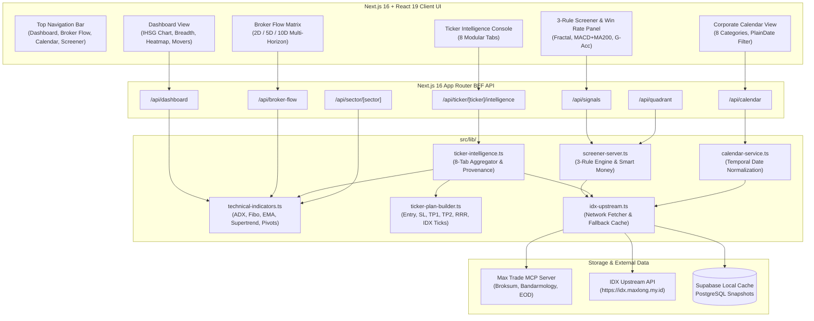

# SahamTeknikal — System Architecture & Technical Specification

> **Document Version**: 2.2.0  
> **Target Environment**: Node.js v20+ / Next.js 16 (App Router + Turbopack) / React 19  
> **Upstream Services**: Max Trade MCP Server, IDX Upstream (`https://idx.maxlong.my.id`), Supabase Local Cache  

---

## 1. Architectural Philosophy & Principles

SahamTeknikal follows modern **Vibe Coding** architectural principles: high velocity, uncompromising code aesthetics, zero unnecessary bloat, and ironclad resilience against external network failures:

1. **Backend-for-Frontend (BFF) Orchestration**: The React client NEVER calls raw external APIs or database tables directly. All data access is mediated through Next.js 16 App Router Route Handlers (`src/app/api/*`) which sanitize, aggregate, calculate derivatives, and cache responses.
2. **Zero-Latency UI Interactions**: Complex views (such as the 2D/5D/10D Broker Flow table and 8-Tab Ticker Console) load instantaneously using pre-aggregated payloads and local state slicing, eliminating turn-by-turn re-fetching.
3. **Strict Data Provenance**: Financial platforms must never hallucinate certainty. Every metric rendered in the UI is tagged with its provenance level:
   * `OBSERVED`: Direct factual exchange data (e.g., closing price, raw broker transaction rows).
   * `DERIVED`: Deterministic algorithmic computations (e.g., $\text{EMA}_{200}$, $\text{RSI}_{14}$, $\text{ADX}_{14}$, Floor Pivots).
   * `PROXY`: Well-defined approximations used when high-tier institutional feeds are unreachable.
4. **Resilient Degradation**: If an upstream service or MCP tool experiences temporary downtime or rate-limiting, the BFF falls back gracefully to local cached snapshots without throwing unhandled exceptions or crashing the client.

---

## 2. System Architecture Diagram



---

## 3. Subsystem Specifications

### 3.1 Subsystem A: Command Center Dashboard
* **Route**: `/` (`src/app/page.tsx` & `src/components/dashboard-client.tsx`)
* **BFF Route**: `/api/dashboard`
* **Core Components**:
  * **IHSG Real-Time Status**: Displays live composite index level, point change, percentage change, total turnover (Value in Trillions IDR), and volume.
  * **Composite Market Regime**: Determined via moving average confluence of IHSG:
    $$\text{Regime} = \begin{cases}
    \textbf{BULL} & \text{if } P_{\text{IHSG}} > \text{EMA}_{50} \text{ and } \text{EMA}_{50} > \text{EMA}_{200} \\
    \textbf{BEAR} & \text{if } P_{\text{IHSG}} < \text{EMA}_{50} \text{ and } \text{EMA}_{50} < \text{EMA}_{200} \\
    \textbf{NEUTRAL} & \text{otherwise (ranging or transitioning)}
    \end{cases}$$
  * **Market Breadth**: Visual gauge showing advancing vs declining vs unchanged stocks.
  * **IHSG Lightweight Candlestick Chart** (`ihsg-overview-chart.tsx`): 90-day daily OHLCV candlesticks overlaid with $\text{EMA}_{21}, \text{EMA}_{50}, \text{EMA}_{200}$, Supertrend (10, 3.0), and Floor Pivots.
  * **Penopang & Pemberat IHSG** (`market-contributors.tsx`): Top 5 positive and negative index contributors calculated by index point weight:
    $$\Delta \text{Index Points}_i = \frac{\Delta P_i \times \text{Listed Shares}_i}{\text{Base Market Cap}} \times \text{Index Base}$$
    Clicking any ticker immediately routes to `/ticker/[ticker]`.
  * **Sector Heatmap** (`sector-heatmap.tsx`): 11 IDX sectors (Financials, Energy, Basic Materials, etc.) rendered as performant CSS grid tiles with color gradients. Clicking opens `/sector/[sector]` or modal with full constituent ranking.
  * **Market Quadrant Map** (`market-quadrant-map.tsx`): Plots stocks across 4 quadrants ($X = \text{Volume Ratio}, Y = \% \Delta P$). Clicking any quadrant opens `quadrant-all-modal.tsx` showing **all** stocks in that quadrant.

---

### 3.2 Subsystem B: 3-Rule Screening Engine & Smart Money Scoring
* **Engine Core**: `src/lib/screener-server.ts` & `src/lib/screener-types.ts`
* **BFF Route**: `/api/signals?year=2026`
* **Rules Specification**:

#### Rule 1: Fractal Breakout (`FRACTAL_BREAKOUT`)
Identifies stocks breaking out from a Williams 5-bar fractal resistance:
* **Trigger Conditions**:
  1. High price breaks above the most recent 5-bar Upper Fractal:
     $$P_{\text{close}} > P_{\text{fractal\_high}} \quad \text{where} \quad P_{\text{fractal\_high}} = \max(H_{t-2}) \text{ s.t. } H_{t-2} > H_{t-4}, H_{t-3}, H_{t-1}, H_t$$
  2. Volume expansion confirmation:
     $$V_t \ge 1.20 \times \text{SMA}_{20}(V)$$
  3. Close price remains in the upper $35\%$ of the daily trading range (strong buying pressure).

#### Rule 2: MACD & MA 200 Confluence (`MACD_EMA200`)
Filters for early-stage momentum within an established macro uptrend:
* **Trigger Conditions**:
  1. Price trades strictly above the 200-day Exponential Moving Average:
     $$P_{\text{close}} > \text{EMA}_{200}$$
  2. MACD Golden Cross occurs within the last 3 bars:
     $$\text{MACD Line}_{t} \ge \text{Signal Line}_{t} \quad \text{and} \quad \text{MACD Line}_{t-1} \le \text{Signal Line}_{t-1}$$
  3. MACD Histogram $> 0$ and expanding ($\text{Hist}_t > \text{Hist}_{t-1}$).

#### Rule 3: G Accumulation (`G_ACC`)
Institutional footprint detection at a base accumulation structure:
* **Trigger Conditions**:
  1. Price is trading near historical support boundary ($\le 1.05 \times \text{Support}$).
  2. Institutional absorption volume:
     $$V_t \ge 1.50 \times \text{SMA}_{20}(V)$$
  3. Narrow price spread compared to volume (effort vs result signature).

#### 🛡️ Smart Money Scoring Algorithm (3 Factors)
For every detected signal, the engine computes an integer score from $0$ to $3$:

```
Factor 1: Broker Accumulation
  Condition: Top-1 to Top-5 Buyer concentration confidence >= 60%
  Point: +1

Factor 2: Foreign Inflow
  Condition: Net Foreign Flow > 0
  Point: +1

Factor 3: Bandarmology Alignment
  Condition: Broker net accumulation trend aligns with price trend direction
  Point: +1
```

* **Score 3/3**: `STRONG CONFIRMATION` (Triple alignment of broker, foreign, and price structure).
* **Score 2/3**: `CONFIRMED` (Dual confirmation; high probability swing setup).
* **Score 1/3**: `PARTIAL` (Single factor confirmation; monitor for follow-through).
* **Score 0/3**: `NOT CONFIRMED` (Technical breakout lacks institutional backing; caution).

#### 🧭 Stock Regime Matrix
* **MARKUP**: $P_{\text{close}} > \text{EMA}_{21} > \text{EMA}_{50}$, trend slope is positive, broker accumulation present $\rightarrow$ Priority **BUY**.
* **MARKDOWN**: $P_{\text{close}} < \text{EMA}_{21} < \text{EMA}_{50}$, downward trend, broker distribution dominant $\rightarrow$ Priority **SELL / AVOID**.
* **CONSOLIDATING**: Price oscillating between $\text{EMA}_{21}$ and $\text{EMA}_{50}$ $\rightarrow$ **WAIT FOR BREAKOUT**.

#### 📊 Historical Win Rate Tracking Algorithm
Calculates statistical accuracy across all recorded signal events:
1. **TP1 Before SL**: Sinyal dinyatakan MENANG jika $H_{\tau} \ge \text{TP1}$ pada hari $\tau > t_{\text{signal}}$ SEBELUM $L_{\tau} \le \text{SL}$.
2. **TP2 Before SL**: Sinyal dinyatakan MENANG jika $H_{\tau} \ge \text{TP2}$ SEBELUM $L_{\tau} \le \text{SL}$.
3. **Naik Tanpa SL (5D / 10D / Sampai Terbaru)**: Sinyal dinyatakan MENANG jika $H_{\tau} > P_{\text{signal}}$ dalam rentang hari bursa tanpa pernah menyentuh $\text{SL}$.
* **Clean Metric Isolation**: Deprecated strategies (`BETA BREAKOUT`, `EARLY SWEEP`, `SMART GAMMA`, `SMART SNIPER`, `V-SHAPE`) are cleanly removed from active computation.

---

### 3.3 Subsystem C: Multi-Horizon Broker Flow (`/broker-flow`)
* **Route**: `/broker-flow` (`src/app/broker-flow/page.tsx` & `src/components/broker-flow-client.tsx`)
* **BFF Route**: `/api/broker-flow`
* **Architecture**:
  * Simultaneous retrieval of **2D**, **5D**, and **10D** broker summary data.
  * In-memory tab switching (0ms latency, zero re-fetching).
  * Broker Classification Matrix: Categorizes market participants into Domestic Institutional (CC, NI, KI), Foreign Institutional (AK, BK, ZP, RX), and Retail (YP, PD, XC, NI).
  * Dynamic Volume Anomaly detector: Flags instances where broker buy/sell volume $> 2.0\times$ 20-day moving average.

---

### 3.4 Subsystem D: Corporate Actions Calendar (`/calendar`)
* **Route**: `/calendar` (`src/app/calendar/page.tsx` & `src/components/calendar-client.tsx`)
* **BFF Route**: `/api/calendar`
* **Date Integrity Architecture (`Temporal.PlainDate`)**:
  * Financial corporate actions operate strictly on calendar dates (`YYYY-MM-DD`), not timestamps.
  * Uses `temporal-polyfill` implementing the TC39 `Temporal` specification:
    ```typescript
    // Guaranteed timezone-safe parsing without UTC shift
    const plainDate = Temporal.PlainDate.from(dateString);
    const isPast = Temporal.PlainDate.compare(plainDate, today) < 0;
    ```
  * Prevents the notorious JavaScript `new Date("2026-11-30")` timezone bug which shifts dates to `2026-11-29` in Western Indonesia Time (WIB / UTC+7).
* **8 Corporate Action Classifications**:
  1. `DIVIDEND` (Amount, Cum Date, Ex Date, Recording Date, Payment Date)
  2. `STOCK SPLIT` (Ratio, Old Nominal, New Nominal, Effective Date)
  3. `REVERSE SPLIT` (Consolidation Ratio, Effective Date)
  4. `RIGHT ISSUE` (Exercise Price, Ratio, Trading Period)
  5. `TENDER` (Offer Price, Tender Period)
  6. `RUPS` (AGMS/EGMS, Time, Venue, Agenda)
  7. `PUBEX` (Public Expose Schedule, Venue, Presentation Time)
  8. `IPO` (Listing Date, Price Range, Lead Underwriter)

---

### 3.5 Subsystem E: 8-Tab Ticker Intelligence Console (`/ticker/[ticker]`)
* **Route**: `/ticker/[ticker]` (`src/app/ticker/[ticker]/page.tsx` & `src/components/ticker-detail-client.tsx`)
* **BFF Route**: `/api/ticker/[ticker]/intelligence`
* **Core Modules**:
  * `src/lib/ticker-intelligence.ts`: Unified data fetcher & normalizer that aggregates upstream market feeds into an immutable, strongly-typed JSON contract.
  * `src/lib/ticker-plan-builder.ts`: Generates tactical trade plans:
    * **Action Synthesis**: `BUY`, `SPECULATIVE BUY`, `WAIT AND SEE / HINDARI DULU`, or `TAKE PROFIT / EXIT`.
    * **IDX Tick Size Rounding**: Conforms strictly to IDX tick sizes:
      $$\text{Tick Size} = \begin{cases}
      \text{Rp 1} & \text{if } P < 200 \\
      \text{Rp 2} & \text{if } 200 \le P < 500 \\
      \text{Rp 5} & \text{if } 500 \le P < 2000 \\
      \text{Rp 10} & \text{if } 2000 \le P < 5000 \\
      \text{Rp 25} & \text{if } P \ge 5000
      \end{cases}$$
    * **Target Calculation**:
      * $\text{SL} = \text{Support}_1 - 1 \text{ tick}$
      * $\text{TP1} = \text{Resistance}_1$
      * $\text{TP2} = \text{Resistance}_2 \text{ or } \text{Fibonacci } 61.8\%$
      * $\text{Risk-Reward Ratio (RRR)} = \frac{\text{TP1} - P_{\text{entry}}}{P_{\text{entry}} - \text{SL}}$
  * **8 Modular Tab Components** (`src/components/ticker-tabs/`):
    * `tab-rekomendasi.tsx`: Tactical plan card, action verdict, key risk drivers, confirmation triggers.
    * `tab-bandar.tsx`: Multi-horizon institutional net flow (1D, 5D, 20D, 30D), Bandar value MA, absorption score.
    * `tab-broker.tsx`: Broksum top 5 buyer/seller table, average price comparison, duel bar visualization.
    * `tab-teknikal.tsx`: Complete technical indicator matrix, ADX(14) trend strength gauge, 90-day Fibonacci Retracement grid, floor pivots, and quick canvas chart toggle.
    * `tab-pro-intel.tsx`: Institutional liquidity footprints, block trades, distribution anomalies.
    * `tab-ownership.tsx`: Beneficial ownership breakdown (Government, Institutional, Foreign, Retail) and recent changes in controlling shareholdings.
    * `tab-corp-actions-news.tsx`: Integrated timeline of corporate actions and sentiment-analyzed market news.

---

## 4. Technical Indicators Math Specification

Located in `src/lib/technical-indicators.ts`:

### 4.1 Average Directional Index ($\text{ADX}_{14}$)
Quantifies trend strength regardless of direction:
1. True Range ($\text{TR}$):
   $$\text{TR}_t = \max(H_t - L_t, |H_t - C_{t-1}|, |L_t - C_{t-1}|)$$
2. Directional Movement ($+\text{DM}, -\text{DM}$):
   $$+\text{DM}_t = \begin{cases} H_t - H_{t-1} & \text{if } H_t - H_{t-1} > L_{t-1} - L_t \text{ and } > 0 \\ 0 & \text{otherwise} \end{cases}$$
   $$-\text{DM}_t = \begin{cases} L_{t-1} - L_t & \text{if } L_{t-1} - L_t > H_t - H_{t-1} \text{ and } > 0 \\ 0 & \text{otherwise} \end{cases}$$
3. Smoothed $+DI_{14}, -DI_{14}$ and Directional Index ($\text{DX}$):
   $$\text{DX} = 100 \times \frac{|+DI - -DI|}{+DI + -DI}$$
   $$\text{ADX}_{14} = \text{WilderSmoothed}(\text{DX}, 14)$$
* **Interpretation**: $\text{ADX} \ge 25 \rightarrow \textbf{STRONG TREND}$; $\text{ADX} < 20 \rightarrow \textbf{CHOPPY / SIDEWAYS}$.

### 4.2 Fibonacci Retracement (90-Day Lookback)
Computed over the trailing 90 trading sessions:
$$\Delta P = P_{\text{high}}^{90D} - P_{\text{low}}^{90D}$$
* Level $0.0\% = P_{\text{high}}$
* Level $23.6\% = P_{\text{high}} - 0.236 \times \Delta P$
* Level $38.2\% = P_{\text{high}} - 0.382 \times \Delta P$
* Level $50.0\% = P_{\text{high}} - 0.500 \times \Delta P$
* Level $61.8\% = P_{\text{high}} - 0.618 \times \Delta P$ (Golden Pocket)
* Level $78.6\% = P_{\text{high}} - 0.786 \times \Delta P$
* Level $100.0\% = P_{\text{low}}$

---

## 5. UI/UX Design System & Performance

Designed according to `/userinterface-wiki` and `/modern-web-guidance`:
1. **Theme Tokens**:
   * Canvas Background: `#0a0d14`
   * Surface Card: `#111622`
   * Border Outline: `#1a2030`
   * Accent Violet: `#8b5cf6`
   * Bullish Green: `#10b981`
   * Bearish Red: `#ef4444`
2. **Container Queries**:
   ```css
   @container (max-width: 720px) {
     .responsive-table {
       display: flex;
       flex-direction: column;
       gap: 0.75rem;
     }
   }
   ```
   Tables dynamically transition to mobile card stacks when space is constrained without requiring global viewport media queries.
3. **Core Web Vitals**:
   * **LCP (Largest Contentful Paint)**: $< 1.2\text{s}$ via server components and streaming boundaries.
   * **CLS (Cumulative Layout Shift)**: $< 0.05$ via fixed height canvas slots and skeleton placeholders.
   * **INP (Interaction to Next Paint)**: $< 50\text{ms}$ via lightweight canvas renderers.

---

## 6. Verification & Test Suite

The codebase is protected by automated tests using the native Node.js test runner (`node --test`):

```bash
npm run test:unit
```

| Test File | Target Module | Scope |
| :--- | :--- | :--- |
| `tests/indicators-adx-fibo.test.mjs` | `technical-indicators.ts` | $\text{ADX}_{14}$, 90D Fibonacci retracements, IDX tick rounding |
| `tests/screener-v2.test.mjs` | `screener-server.ts` | 3-Rule evaluation, Smart Money scoring (3/3), regime classification |
| `tests/temporal-dates.test.mjs` | `temporal-dates.ts` | `Temporal.PlainDate` formatting, WIB boundary safety |
| `tests/ticker-intelligence.test.mjs` | `ticker-intelligence.ts` | 8-Tab data contracts, tactical plan synthesis, provenance tags |

**Total passing unit tests**: 49 / 49 tests.
